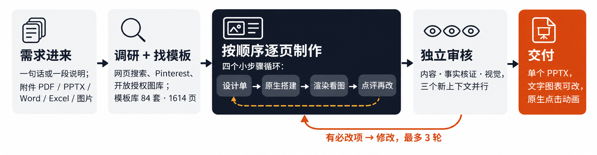
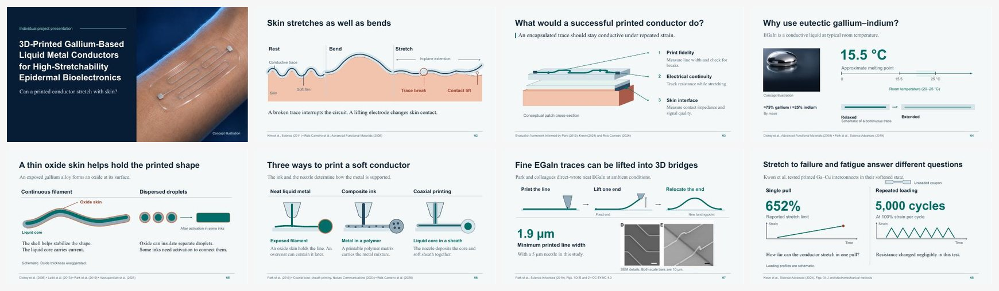
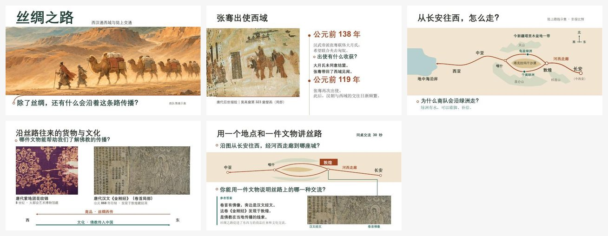
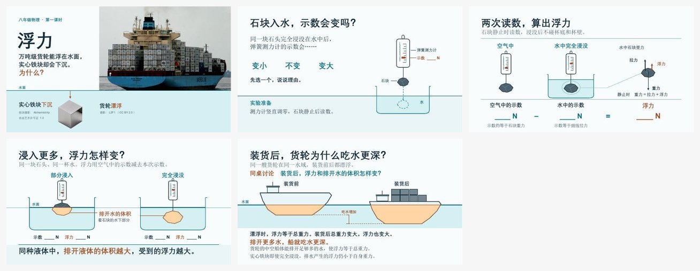
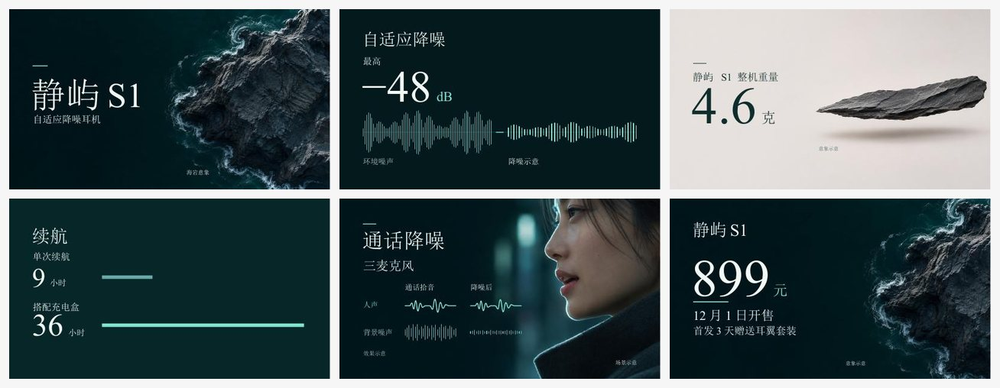

# Rick PPT · 一句需求，交付一个可编辑的 PPTX

[](https://rickppt.aaarickmorty.chatgpt.site)

**[进入网站 · 在线制作 PPT →](https://rickppt.aaarickmorty.chatgpt.site)**　·　[成品示例](examples/README.md)　·　[独立 Skill](#独立-skill任何-agent任何系统)

写一句话或一段需求（可以带 PDF、PPTX、Word、Excel、图片），模型完成调研、逐页设计和制作、自查和独立审核，交付**一个**PowerPoint 文件：文字、图形、图表都是原生对象，可以直接在 PowerPoint 或 WPS 里改，并带原生点击动画。



## 工作流

| 步骤 | 做什么 | 程序强制检查 |
| --- | --- | --- |
| **1 需求进来** | 用户原话、页数、语言、新建/修改、附件。Excel 按工作表读成表格。 | 页数前后矛盾会请用户确认；修改模式必须附一个 PPTX |
| **2 调研 + 找模板** | 独立的调研阶段：网页搜索、Pinterest、开放授权图库，核实事实和图片授权；在自建模板库里按需求找整套模板或单页灵感 | 产出大纲、资料笔记、决策单，格式不合格不能进入制作 |
| **3 按顺序逐页制作** | 同一个会话从第 1 页做到最后一页；每页先写设计单，再用原生对象搭建，渲染出图自己看，必要时请另一个模型点评后再改 | 设计单要写要点、主角、阅读顺序、真实锚定物、借用的现实形式，并写出“平均做法”然后避开 |
| **4 独立审核** | 内容、事实核证、视觉三个审核员在新上下文里并行看成品，看不到作者的思路 | 有必改项就回到作者原会话修改，最多 3 轮；改完变差就回退 |
| **5 交付** | 审核过的那个文件原样交付 | 交付文件按哈希核对；拒绝米白底和米白大色块；提醒大面积浅色卡片、整套低饱和灰蓝灰绿、空白填写线；讲稿里混入来源和设计备注直接退回 |

用户没给的自己的数字（价格、团队规模等），模型会填一个合理的示例值，并在同页用小字标明“示例数字，非真实数据”；外部事实必须真实、有来源。

规则分两类：写给模型看的设计方法和例子（读了不一定照做），以及由程序执行的检查（不合格就退回或提醒）。经验是关键行为都要有程序兜底。一个完整例子（初二物理“浮力”5 页课件，38.9 分钟）逐步讲解见 [工作流说明](docs/workflow-walkthrough.md)。

## 成品示例

| | |
| --- | --- |
| [](examples/3d-printing-liquid-metal.pptx)<br>**3D 打印液态金属电子皮肤** · 学术汇报 · 15 页 · 英文 | [](examples/silk-road.pptx)<br>**丝绸之路** · 历史课件 · 5 页 |
| [](examples/buoyancy-lesson.pptx)<br>**浮力** · 初二物理课件 · 5 页 | [](examples/anc-headphones-launch.pptx)<br>**降噪耳机发布** · 发布会大屏 · 6 页 |
| [](examples/van-gogh-starry-night.pptx)<br>**梵高《星空》** · 艺术赏析 · 10 页 | [](examples/specialty-coffee-brand.pptx)<br>**精品咖啡豆** · 品牌介绍 · 8 页 |

点击预览图下载原始 PPTX。更多案例（游戏宣发、海报、论文图复刻）见 [examples/](examples/README.md)。

## 独立 Skill：任何 Agent、任何系统

已打包为 **rick-pptx**，可下载最新 GitHub Release 的 **[安装包](https://github.com/dijiahU/rick-ppt/releases/latest/download/rick-pptx.zip)**。解压后把 `rick-pptx` 文件夹放进宿主的技能目录（Codex、Claude Code 等），或让任意 agent 读取 `SKILL.md`。

| | 需要什么 | 说明 |
| --- | --- | --- |
| **Agent** | 能跑命令、能看图片、能联网搜索、能开一个新上下文做审核 | Codex、Claude Code、Cursor、Gemini CLI、OpenCode、自己的 API 循环都可以；缺哪一项、怎么降级见 [Any agent, any OS](tools/skill-packaging/rick-pptx/references/any-host.md) |
| **模型 / API** | 宿主自己的模型或 API key | Skill 不带任何密钥。网站执行端默认 Codex，也可以接 OpenAI 兼容的 Responses / Chat Completions 接口（[说明](docs/model-api-switching.md)）；完整托管流程可用 DSH 引擎 |
| **系统** | macOS · Windows · Linux | Python 3.11+、LibreOffice、Poppler；Windows 需 `setx PYTHONUTF8 1`。先运行 `scripts/doctor.py` 自检 |
| **联网搜索** | 宿主自带的搜索即可 | Pinterest / Google 图片的浏览器登录搜索是可选增强，需要单独登录一次，目前只支持 macOS / Linux |

验证范围：核心工具在 macOS 上有完整测试，Windows 的文件锁和字体路径由模拟测试覆盖，尚未在真机 Windows 上跑过完整任务。

维护时用 `python3 tools/build-skill.py --output /path/to/fresh-output` 从插件源码重新打包。

## 模板库

制作时检索的是一个自建 PPTX 模板库（84 套、1614 页，每页带页面类型、版式描述和质量分）。模板来自 WPS，有版权，**不随仓库发布**；仓库里只有建库和检索代码（`tools/build-template-library.py`、`tools/tag-template-library.py`、`runner/reference_library.py`），可以用自己的模板建库。没有模板库时这一步返回空结果，其余流程照常。

## 本地运行与仓库结构

- `pptx-agent/`：Codex 插件、原生制作工具、设计和审核文档、单元测试
- `runner/`：网站任务执行端（调研 → 制作 → 审核 → 修改 → 交付）
- `workflow/`：日志与 Codex app-server 传输
- `website/`：线上网站源码（Next.js），本地运行需自行配置登录、数据库、存储
- `tools/build-skill.py`、`tools/skill-packaging/`：由同一套源码构建独立 Skill，ZIP 随 GitHub Release 发布

本地初始化和启动见 [环境隔离说明](docs/environments.md)，生产部署见 [deploy/](deploy/README.md)。插件安装：

```bash
cd pptx-agent
python3.11 -m venv .venv
.venv/bin/python -m pip install -e .
.venv/bin/pptx --help
```

用户任务、账号凭证、运行日志、本地配置和模板库不上传。静态渲染不能证明 PowerPoint 中动画、视频等的播放效果完全一致。
