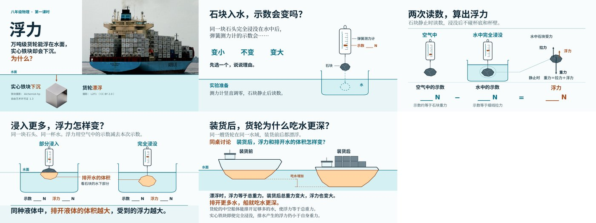

# Rick-PPT 工作流说明（当前版本 opt22，以“初二物理·浮力”任务为例）

> 例子是 2026-11-21 的真实任务 4b35a3c9（当时版本 opt10，模型 gpt-6.2-sol，推理强度 xhigh）。每一步先讲当前版本怎么做，再讲浮力任务当时实际发生了什么；浮力任务之后才加的功能，单独标“现在又加了”。所有数字来自任务记录。

## 系统是什么

Rick-PPT 是一个把用户需求变成**可编辑 PPTX** 的系统。用户在网站上写一句或一段需求（可带附件），后台由 GPT（通过 Codex 运行）完成调研、逐页制作、自查和修改，最后交付一个 PowerPoint 文件。文件里的文字、图形、图表都是原生对象，可以直接在 PowerPoint 或 WPS 里改，并带原生点击动画。

系统有两类约束：
- **文档规则**：写给模型看的设计方法、例题和对比图（怎样定主角、怎样排辅助文字、什么是 AI 味等）。模型读了不一定照做。
- **宿主强制检查**：由程序执行，不合格就退回或提醒。例如：每页动手前必须提交设计单且字段合格；保存时拒绝米白底和米白大色块，提醒单位压在数字上、连续素白页、空白填写线、大面积浅色卡片、整套低饱和灰绿灰蓝配色，讲稿里混入来源标签直接退回；修改后若设计变差就回退到上一版。

经验是：只写在文档里的规则常被忽略，关键行为都要有宿主检查兜底。

整个任务分为：需求进来 → 调研（含模板库检索）→ 连续制作（每页先写设计单、边做边看渲染）→ 独立审核（内容、视觉并行）→ 修改轮（最多 3 轮审核）→ 收尾修整 → 交付。

---

## 第 1 步　需求进来

**做什么**：网站把用户原话、页数、语言、任务模式（create 新建 / edit 修改现有 PPT）、附件交给后台。页数可以写在需求里，系统会自动识别；需求里出现两个不同页数会请用户确认。edit 模式必须正好附一个 PPTX。

**浮力任务**：用户原话——
> 我是初二物理老师，下周讲“浮力”第一课时，帮我做 5 页课件，教室投影用。要从生活现象引入（比如为什么万吨巨轮能浮在水上、铁块却会沉），让学生先猜再做实验：用弹簧测力计称石块在空气中和浸在水中的示数，算出浮力，再改变浸入的体积看浮力变化。最后引出“浮力的大小跟排开液体的体积有关”。要有一个课堂提问让学生讨论。

参数：5 页、中文、create、无附件。

**现在又加了**：附件上限 60MB；附件支持 pdf、pptx、docx、xlsx（Excel，本周新加，模型用专门脚本把每个工作表读成表格）、txt、md、csv、图片。用户没给的自己的数字（价格、融资额、团队等），模型先填一个合理的示例数字，并在同页用小字标明“示例数字，非真实数据”，不再留“待补”；外部事实仍必须真实、有来源。

---

## 第 2 步　到模板库找模板

**做什么**：我们自建了一个 PPTX 模板库：从 WPS 下载并人工筛选的 **84 套模板、1614 页**。每页都有视觉标签：页面类型（封面、目录、章节、对比、图文、数据……）、版式描述、长处、质量分。工具 `pptx_reference_library` 提供这些动作：
- `templates`：按需求给整套模板排名，看它对六种页面角色（封面、目录、章节、内容、数据、结尾）的覆盖和匹配度，决定能不能拿来当底稿；
- `inspire`：按“这页的结构任务”找单页灵感，例如“一个关键数字加两条说明”，不限行业；
- `search`、`deck`、`pick`、`template`：按语义搜单页、看整套、挑选并放大、把模板文件复制进任务；
- `craft`：6 张“修改前/修改后”对比图，左边是 GPT 真做过的弱页，右边是同样内容的重做。对应 6 种手法：第二个面、字即是图、反复标记、强网格、少量精确字重、现实锚定物。

**为什么**：模型凭空设计容易落到“平均方案”。真实设计师做的页面给它构图和比例的依据。模板只在合适时才当底稿，否则只借单页的关系。

**浮力任务**：
- 调研阶段先用 `templates` 在“教学课件”类里检索，查询词是“初中课堂 教室投影 教学课件 科学物理 实验现象引入 实验对照 课堂讨论 结论”。
- 然后翻看了两套课件：《三国至隋唐的文化》公开课和《敦煌壁画》美术课。从后者挑出第 10 页（赭褐满版底、居中白色问句标题的章节页）研究构图。
- 两套都不适合整套套用，模型从空白开始设计，逐页借参考（见第 4、5 步）。

---

## 第 3 步　调研

**做什么**：调研是一个独立阶段，模型只做研究和规划，不做幻灯片。产出三份文件：
- 大纲 `outline.json`：每页标题和要点；
- 资料笔记 `source-notes.md`：查到的事实、来源、逐页教学计划；
- 决策单 `decision-plan.json`：用什么资料、哪些页要点击动画、参考作品登记。

**浮力任务（7.0 分钟）**：
- **9 次网页搜索**，包括：
  - 人教版八年级物理第十章第一节教案和国家中小学智慧教育平台；
  - 教育部《中小学实验教学基本目录》；
  - OpenStax《大学物理》11.7 阿基米德原理；
  - 马士基货轮 Olga Maersk 的资料；
  - David Macaulay《The Way Things Work》、Nigel Holmes 的科普图解，作为视觉参考。
- **3 次 Pinterest 浏览**：中文 2 次（“浮力 科学实验 科普 插图 图解”），英文 1 次（“physics science textbook water buoyancy diagram editorial illustration”）。
- **3 次开放授权图库搜索**：海上集装箱船、弹簧测力计。
- 找到一张 DK 出版社《DK Wissen. Natur & Technik》的样张，登记为“研究水线和船体剖面关系”的视觉参考，不放进课件。
- 核实了货轮照片的授权（Flickr 摄影者 L2F1，CC BY 2.0）。
- 定下 5 页结构：生活现象设问 → 先猜示数 → 两次读数算浮力 → 改变浸入体积 → 同桌讨论货轮吃水。实验读数留空给课堂实测。

---

## 第 4 步　开始制作

**做什么**：
- 制作阶段是一个**连续的 GPT 会话**，按演示顺序一页一页做，不先挑几页试做。
- 每页用原生对象搭建：文本框、形状、连线、原生图表、导入的图片。
- 每页做完立刻渲染出图自己看。
- 多步骤的页面用原生点击动画按讲解顺序逐步出现。

**浮力任务（18.8 分钟）**：
- 5 页全部按顺序做完：50 次命令执行、22 次文件修改、14 次看图。
- 所有实验装置（测力计、烧杯、石块、受力箭头、货轮剖面）都是原生矢量形状，可以直接改。
- 第 2–5 页都有点击动画。例如第 3 页：入场只有空气中的读数；点击一出现水中示数；点击二出现水中石块受力图；点击三出现减法算式。
- 制作中又补找了一张纯铁立方体的授权照片（Wikimedia，自由艺术许可证），放在封面“实心铁块下沉”旁边。

---

## 第 5 步　制作前的每页制作清单（设计单）

**做什么**：每页动手前，模型必须用 `pptx_page_design_context` 提交设计单，宿主检查合格才保存。当前版本的要求：

- **整套场合单 `deck_plan`**（第一个关键页之前）：
  - 场合、观众、希望观众有的感受、观众期待看到什么、主题、不该出现的样子；
  - 庆典场合必须写出喜庆情绪和人物。
- **关键页（封面、结尾和重要页）8 项**：
  1. 要点：一句话结论，做标题；
  2. 内容关系：谁/多少/哪里/何时/怎样/为什么；
  3. 步骤：观众要依次看几样东西，每样何时出现；
  4. 主角：哪一个元素，占画面多少；
  5. 阅读顺序：①②③；
  6. 删减：只删装饰和凑数，不删实质；
  7. 视觉想法：必须用到本页内容里的词或数字，只写风格词会被打回；
  8. 放弃的方案：写明备选方案，以及它为什么更难读。
- **普通页**：要点、内容关系、阅读顺序、本页的设计手段。
- **所有页都要填**：参考（模板库页 id 或 craft-N）。
- **现在又加了三项，所有页都要填**：
  - **锚定物**：真实数字、标明“示例”的数据、原话或具体场景；
  - **借用的现实形式**：小票、标签、日历、车票等，并要在画面上画出至少两个特征；
  - **平均做法**：写出这页最常见的排法，并且不用它。

宿主还会提醒：渲染时这页没设计单，提示先补；同一个 craft 手法被一半以上页面使用，提示换一种。

**浮力任务**：这是设计单第一次改成“动手前提交”的版本（当时还没有 deck_plan、reference 和三项新字段）。
- 共提交 7 次，2 次被打回：
  - 封面第一次“放弃的方案”只写了“照片铺满裁成扁幅会切掉水线”。宿主要求写明备选方案和它难读的原因，改成：
    > 备选是照片整幅铺满，因为裁剪会使船体接水处消失，学生难以判断船是否漂浮。
  - 第 3 页第一次写了 4 个阅读顺序（上限 3 个），合并后通过。
- 第 3 页（两次读数算浮力）通过的设计单原文：
  - 要点：空气中的示数减去水中的示数，就是石块受到的浮力。
  - 主角：两个实验状态在下方列成减法的两个输入，占版面一半多。
  - 视觉想法：把空气中的示数与水中的示数直接落在各自装置下方，减号和等号把它们连到浮力。
  - 放弃的方案：备选是独立放一个公式框，因为学生要额外找到哪一个读数在减号前。
- 第 4 页视觉想法：“用同一条水线比较两种状态，暖色只覆盖石块水下部分，让排开液体的体积可见。”
- 第 5 页视觉想法：“同一条水线截过两条相同船体，装货后船体下移，暖色排水部分随之变大。”

成品逐页核对，这些想法都做出来了。整套用同一种“水线”语言：封面的真实水线、第 4 页的杯中水线、第 5 页的船体水线。

---

## 第 6 步　联网工具搜索

**做什么**：除了模型自带的网页搜索，我们给它加了几类联网工具（以当前代码为准）：

| 工具 | 用途 |
|---|---|
| `web_search`（Codex 内置） | 公开网页搜索，一次可带多条中英文网页查询和图片查询（image_query） |
| `pptx_search_sources` | 把互不依赖的调研问题分给最多 3 个独立搜索会话，并行查 |
| `pptx_browser_sources` | 通过已授权的 Edge 浏览器搜 Pinterest、Google（可只看 CC 许可图片）、bestpitchdeck，最多 4 个请求并行，返回截图证据 |
| `pptx_browse` | 在登录的 Edge 里读指定网页，截图存为参考；Pinterest 页可把结果大图存下（最多 8 张）仔细看 |
| `pptx_open_images` | 开放授权图库：Openverse、Wikimedia Commons、大都会博物馆、芝加哥艺术博物馆，带许可证信息 |
| `pptx_icons` | Iconify 图标库，选中的图标转成可改色的原生矢量 |
| `pptx_generate_image` | 内置生图，用于原创示意插图（标明是示意，不冒充真实照片） |

另有本地工具：模板库 `pptx_reference_library`、参考研究 `pptx_study_reference`、设计点评 `pptx_design_critique`、设计单 `pptx_page_design_context`。图片都经过宿主代理下载并记录来源和授权。

**浮力任务里的调用次数**：

| 工具 | 调研阶段 | 制作阶段 |
|---|---|---|
| `web_search` | 9 | 4 |
| `pptx_browse`（Pinterest，中文 2、英文 1） | 3 | — |
| `pptx_open_images` | 3 | 1 |
| 模板库 | 5 | 8 |

模板库在制作阶段的 8 次是：4 次 inspire 找单页灵感，4 次 pick 放大研究。`pptx_search_sources` 和 `pptx_browser_sources` 这次没有用到。

---

## 第 7 步　制作时的视觉审核

**做什么**：制作中模型自己看图，有三个工具：
- `pptx_study_reference`：研究参考页的构图（study）；画三版灰块草图，并标出“典型度”以便放弃最平庸的一版（sketch）；用“第一次看”的眼光检查自己的渲染图（fresh_eyes）；放大局部（crops）。
- `pptx_page_design_context` 带渲染图回看：宿主把这页的设计单一起返回，要求对照三件事——主角是不是 hero、视线是否按阅读顺序走、视觉想法是否做出来。没做到就改页面，不许改设计单迁就现状。
- `pptx_design_critique`：把渲染图和参考图交给另一个模型做设计点评（当前用 Claude，GPT 备用），给出评分、该保留的地方和修改指令。

**浮力任务**：制作阶段调用参考研究 12 次、设计点评 3 次（第 1 页、第 2 页、全 5 页一次）、看图 14 次。每个关键页都按“先找参考 → 灰块草图 → 提交设计单 → 搭建 → 渲染 → 第一次看”的顺序进行：
- 封面：inspire“封面 单一真实照片作为主体 图文对照 大标题 水平景观出血”，选中《世界海洋日》模板封面（满版水下照片、左侧大标题）作参考；草图 A“水面上的货轮”。
- 第 3 页：先 inspire“两个并列示意比较前后状态，两个输入在同一行映射到下方一个减法结果”，再参考《中国风茶文化》对称双栏页。
- 第 5 页：参考《敦煌壁画》第 27 页“红圈连线标注对照”。

点评结果的正文这次没有记录下来（记录缺口），只能确认三次调用都成功了。

---

## 第 8 步　做完之后的两轮审核

**做什么**：模型保存候选文件后，宿主先做技术检查，然后**并行**开几个**独立上下文**的审核员。审核员看不到作者的设计记录：
- **内容审核（只看页面）**：只看页面截图，判断观众能不能读懂、有没有遗漏或错误；
- **内容核证**：可以联网，核对事实、单位、例子、来源；
- **视觉审核**：现在默认 Claude，GPT 备用。看完整渲染图和点击状态，判断：
  - 风格合不合场合和观众；
  - 阅读顺序是否和设计单一致；
  - 信息密度；
  - AI 味（米白底、低饱和色、大面积卡片、空白填写线、每页同一套开头等）；
  - 细节。

每条意见标 required（必须改）或 suggestion（建议），并指定修改路线：内容修改、原生修复或保留建议。规则如下：
- 有 required 就进入修改轮，作者在原会话里修改，然后重新审核，最多 3 轮。
- 修改轮只改内容不降设计；改完和上一版比，变差就回退。
- 用户没提供、作者也无法核实的信息（品牌名、价格），只能列为建议。
- 审核通过后还有一次“收尾修整”（polish）：不超过 10 分钟，处理可快速改好的建议，之后再审一次，出现新的必改项就回退。
- 3 轮后仍有问题，也会交付最新版，并把问题列给用户。

**浮力任务**：
- **第 1 轮**：内容审核提出 1 条必改。第 1 页问“货轮为何能浮、铁块为何会沉”，第 5 页只解释了装货后吃水变深，没在画面上回答开场问题。建议在第 5 页第二次点击出现的回扣区补两句。另有建议：
  - 第 5 页“吃水增加”括线没对齐两船船底；
  - 第 3 页受力图引线落在空白处；
  - 第 3 页应注明空气中示数约等于重力。
- **修改 1（5.3 分钟）**：第 5 页底部补上“货轮的中空船体能排开足够多的水，使浮力等于总重力；实心铁块即使完全浸没，排水产生的浮力仍小于自身重力。”
- **第 2 轮**：没有必改，判定可交付。视觉审核指出 AI 味“有一些”：封面照片下缘和示意水线之间露出一条拼接缝，铁块剪影贴近页底。宿主据此触发收尾修整。
- **修改 2（收尾修整，1.8 分钟）**：调整封面照片与水线的衔接，给铁块留出余量。
- **第 3 轮**：可交付，AI 味“无”。审核原话：“新版修整了第 1 页照片与示意水面的接缝，也给铁块留出了页底余量，整体优于基线。”宿主比较修改前后两版，选择修改后的版本（理由：审核确认改进）。剩下的都是建议，例如在预测题里补“与悬在空气中时相比”。

当时视觉审核调用 Claude 失败，三轮都由 GPT 备用完成；现在本机默认由 Claude 做视觉审核和设计点评。

---

## 浮力任务时间线（共 38.9 分钟）

| 阶段 | 开始（分钟） | 用时（分钟） |
|---|---|---|
| 调研（含模板库检索、9 次搜索、3 次 Pinterest、3 次开放图库） | 0.0 | 7.0 |
| 连续制作（5 页、7 次设计单、12 次参考研究、3 次设计点评） | 7.0 | 18.8 |
| 宿主技术检查、保存候选 | 25.8 | 2.3 |
| 第 1 轮审核（内容、内容核证、视觉并行，最长 1.5） | 28.1 | 约 1.5 |
| 修改 1（补回扣开场的必改项） | 28.1 | 5.3 |
| 第 2 轮审核 | 33.4 | 约 1.5 |
| 修改 2（收尾修整封面接缝） | 35.0 | 1.8 |
| 第 3 轮审核 → 交付（2.3MB） | 36.8 | 约 2.1 |

## 配图

- [p1-cover.jpg](assets/buoyancy/p1-cover.jpg)：参考模板库《世界海洋日》封面构图，真实货轮照片加铁块照片，共用一条水线。
- [p3-plan.jpg](assets/buoyancy/p3-plan.jpg)：设计单“读数落在各自装置下方，减号等号连到浮力”的实现。
- [p4-waterline.jpg](assets/buoyancy/p4-waterline.jpg)：“同一条水线、暖色只覆盖水下部分”。
- [p5-review-fix.jpg](assets/buoyancy/p5-review-fix.jpg)：第 1 轮内容审核必改后补上的底部两句。
- [overview.jpg](assets/buoyancy/overview.jpg)：5 页缩略图。

成品文件：[examples/buoyancy-lesson.pptx](../examples/buoyancy-lesson.pptx)
